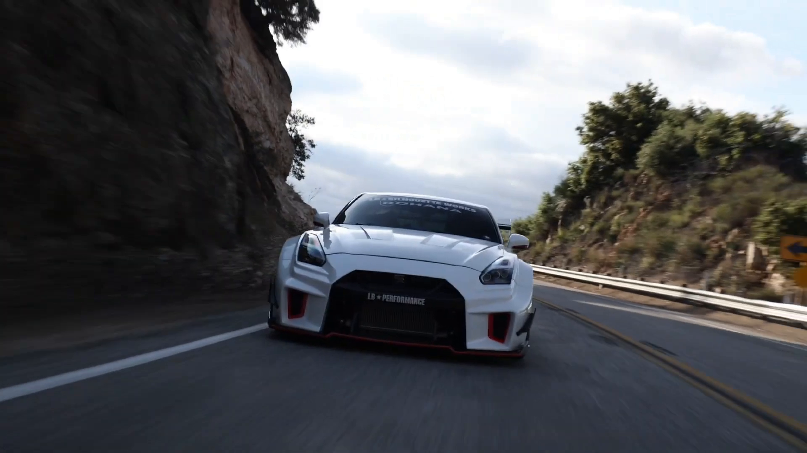
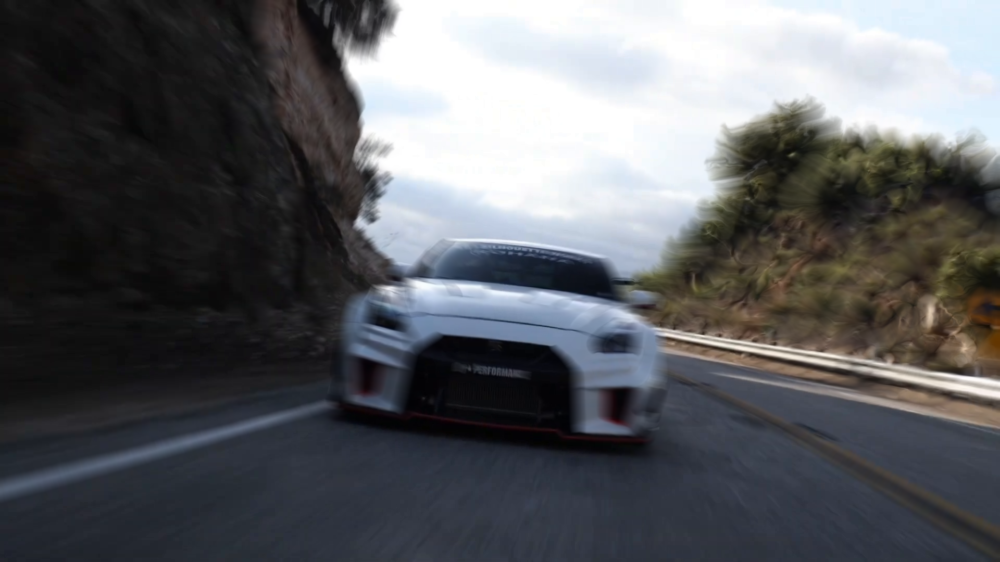
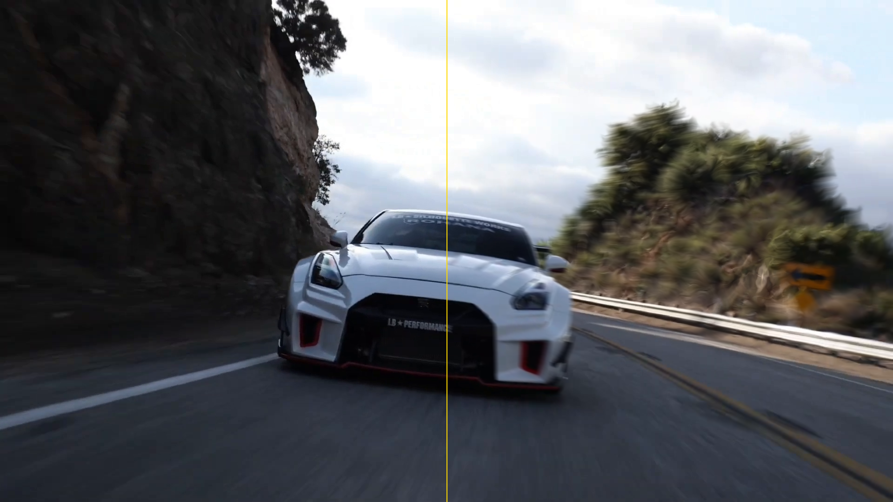
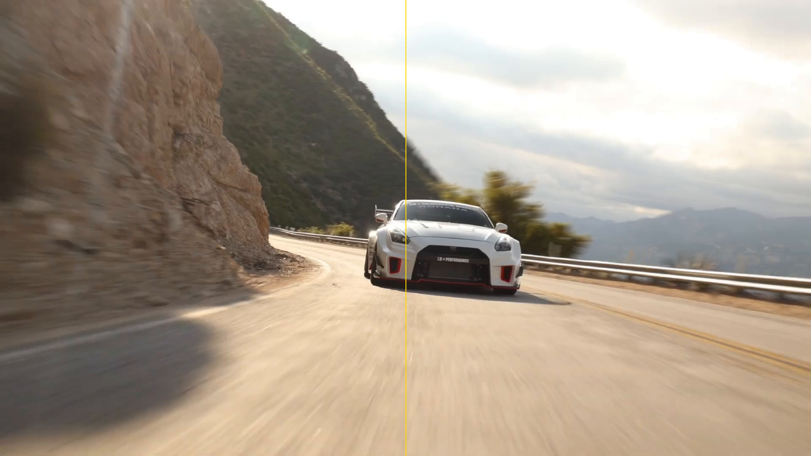
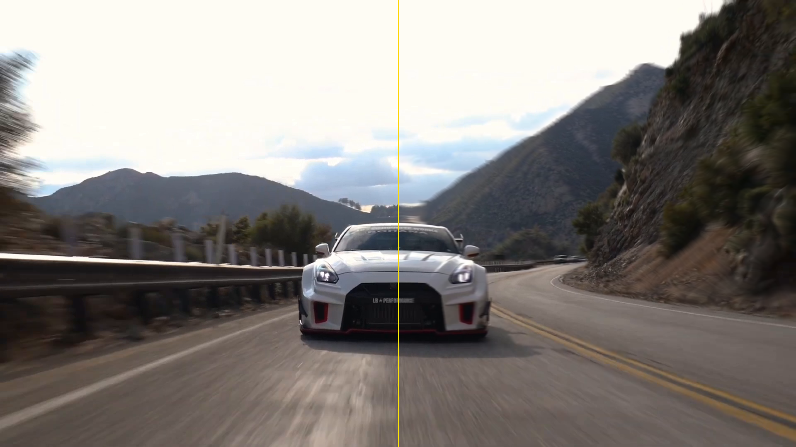
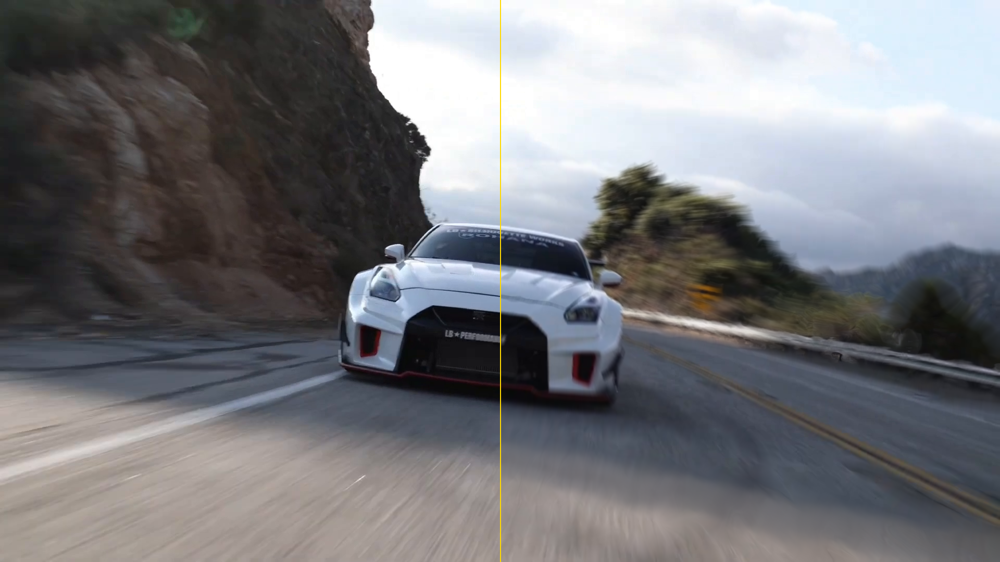
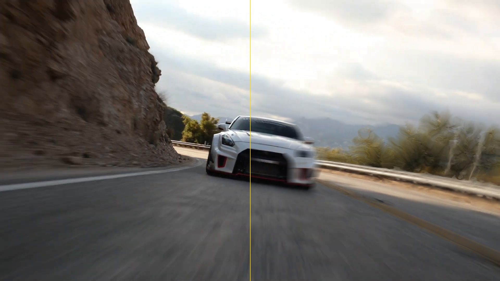
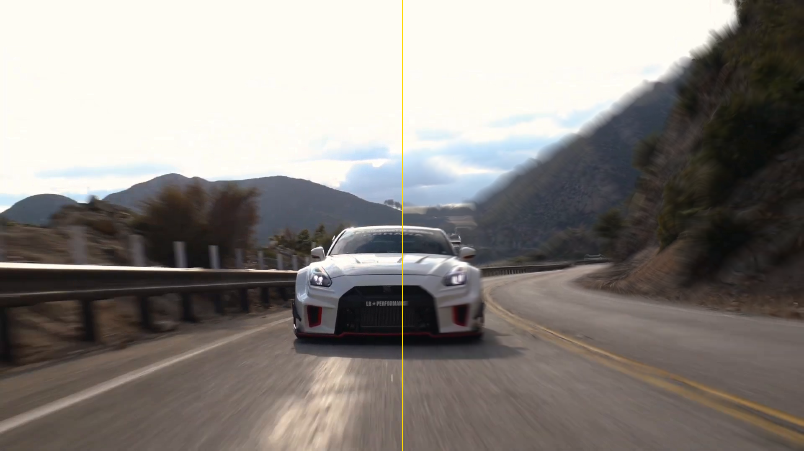

# 🎬 motion_blur_rs — High-Performance Motion Blur Showcase

[](https://www.rust-lang.org)
[]()
[%20%7C%20GPU%20(WGSL)-brightgreen.svg)]()
[]()

A modular, cross-platform motion estimation and temporal shutter blurring engine written in Rust. Inspired by professional VFX plugins like ReelSmart Motion Blur (RSMB), `motion_blur_rs` computes dense optical flow fields across temporal frames and executes 4D sub-frame numerical shutter integration without requiring 3D velocity passes.

---

## ⚡ Quick Start: How to Use the CLI

Process any video file directly using high-speed multi-threaded FFmpeg streaming pipes (with audio stream preservation):

### Prerequisites
Make sure `ffmpeg` and `ffprobe` are installed on your system:
- **macOS:** `brew install ffmpeg`
- **Ubuntu/Debian:** `sudo apt install ffmpeg`
- **Windows:** `winget install Gyan.FFmpeg`

### Command Syntax
```bash
cargo run --release --example process_video -- <input_video> <output_video> [blur_amount] [samples] [frame_limit] [curve]
```

### Common Commands
```bash
# 1. Standard Cinematic Motion Blur
cargo run --release --example process_video -- input.mp4 output_blurred.mp4 3.5 24

# 2. 2X Intense Motion Blur (Ultra-prominent trails)
cargo run --release --example process_video -- input.mp4 output_2x_blurred.mp4 7.0 32

# 3. Quick 30-Frame / 1-Second Preview Test
cargo run --release --example process_video -- input.mp4 preview.mp4 3.5 20 30
```

### CLI Options Reference
| Parameter | Type | Default | Recommended | Description |
| :--- | :---: | :---: | :---: | :--- |
| `input_video` | `path` | *Required* | — | Path to source video (`.mp4`, `.mov`, `.mkv`, etc.) |
| `output_video` | `path` | *Required* | — | Destination path for the motion-blurred video |
| `blur_amount` | `f32` | `0.5` | `3.5` (Normal) / `7.0` (2X) | Shutter length multiplier scaling velocity integration |
| `samples` | `i32` | `16` | `24` – `32` | Sub-frame integration steps (higher = zero stepping artifacts) |
| `frame_limit` | `usize` | `None` | `30` (Preview) | Maximum frames to render (omit to process entire video) |
| `curve` | `usize` | `0` | `0` (Box) / `1` (Gaussian) | Shutter shape: `0 = Box` (constant trail), `1 = Gaussian`, `2 = Triangular` |

---

## 🔍 Full-Frame Comparison: Original (None) vs Implemented Motion Blur

Below is an uncropped 1080p frame from the video comparing the raw, staccato camera capture against the reconstructed motion-blurred frame.

| 1. Original Frame (None — No Blur) | 2. Implemented Motion Blur (Blur Amount: 3.5) |
| :---: | :---: |
|  |  |
| *Discrete camera capture (staccato motion)* | *Reconstructed temporal shutter blur (natural motion streaks)* |

---

## 📸 Selected Split-Screen Comparisons (6 Highlights)

In the split images below:
- **LEFT (Left of Gold Divider):** Original camera frame (**None** / No motion blur).
- **RIGHT (Right of Gold Divider):** Processed with `motion_blur_rs` (**Motion Blurred**).

---

### Part 1: Normal Cinematic Motion Blur (Blur Amount = 3.5, 24 Samples)

Balanced shutter exposure simulating a physical cinema camera shutter.

#### 1. Frame 42 (~1.37s)


#### 2. Frame 98 (~3.23s)


#### 3. Frame 185 (~6.13s)


---

### Part 2: 2X Intense Motion Blur (Blur Amount = 7.0, 32 Samples)

Doubled blur trajectory for fast-action sequences and pronounced stylization with 32 integration steps to eliminate stepping artifacts.

#### 4. Frame 85 (~2.80s)


#### 5. Frame 140 (~4.63s)


#### 6. Frame 200 (~6.63s)


---

## 🧠 Architectural Pipeline

```
               [ Input Video Frames: t-1, t, t+1 ]
                               │
                               ▼
        ┌──────────────────────────────────────────────┐
        │ 1. Multi-Scale Gaussian Pyramid Downsampler  │
        │    Separable 5-tap [1, 4, 6, 4, 1] / 16      │
        └──────────────────────┬───────────────────────┘
                               ▼
        ┌──────────────────────────────────────────────┐
        │ 2. Coarse-to-Fine Optical Flow Estimator     │
        │    Regularized structure tensor optimization │
        └──────────────────────┬───────────────────────┘
                               ▼
        ┌──────────────────────────────────────────────┐
        │ 3. Forward-Backward Consistency & Occlusion  │
        │    Alpha Boost on transparent moving edges   │
        └──────────────────────┬───────────────────────┘
                               ▼
        ┌──────────────────────────────────────────────┐
        │ 4. 4D Temporal Shutter Accumulator           │
        │    Sub-frame sampling along motion paths     │
        └──────────────────────┬───────────────────────┘
                               ▼
            [ Output Frame with Realistic Blur ]
```

---

## 📦 Integrating as a Library into Your Video Editor

Add `motion_blur_rs` to your `Cargo.toml`:

```toml
[dependencies]
motion_blur_rs = { path = "../motion_blur_rs" }
```

Use the plugin contract:

```rust
use motion_blur_rs::{create_motion_blur_plugin, FrameBuffer, PixelFormat, RenderContext, TimeCode, PluginParameters, ParameterValue, MotionBlurPlugin};
use std::collections::HashMap;

// 1. Create plugin instance
let plugin = create_motion_blur_plugin();

// 2. Query temporal dependencies for current timeline timestamp
let current_time = TimeCode::new(1.0, 30.0);
let dependencies = plugin.get_frame_dependencies(current_time);

// 3. Assemble frames
let mut inputs = HashMap::new();
inputs.insert(MotionBlurPlugin::LABEL_PREVIOUS, &frame_prev);
inputs.insert(MotionBlurPlugin::LABEL_CURRENT, &frame_curr);
inputs.insert(MotionBlurPlugin::LABEL_NEXT, &frame_next);

// 4. Configure parameters
let mut params = PluginParameters::new();
params.set(MotionBlurPlugin::PARAM_BLUR_AMOUNT, ParameterValue::Float(3.5));
params.set(MotionBlurPlugin::PARAM_SAMPLES, ParameterValue::Int(24));

// 5. Render
let mut output = FrameBuffer::new(1920, 1080, PixelFormat::Rgba8);
plugin.render(&render_context, &params, &inputs, &mut output)?;
```

---

## 📄 License

Dual-licensed under either of:
- Apache License, Version 2.0 ([LICENSE-APACHE](LICENSE-APACHE))
- MIT license ([LICENSE-MIT](LICENSE-MIT))

at your option.
